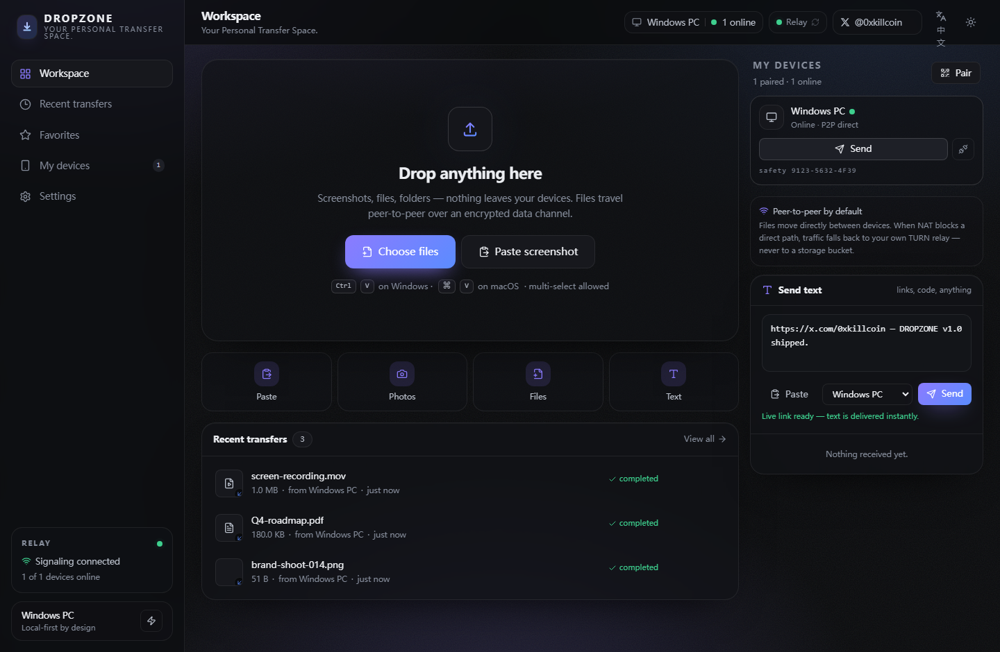
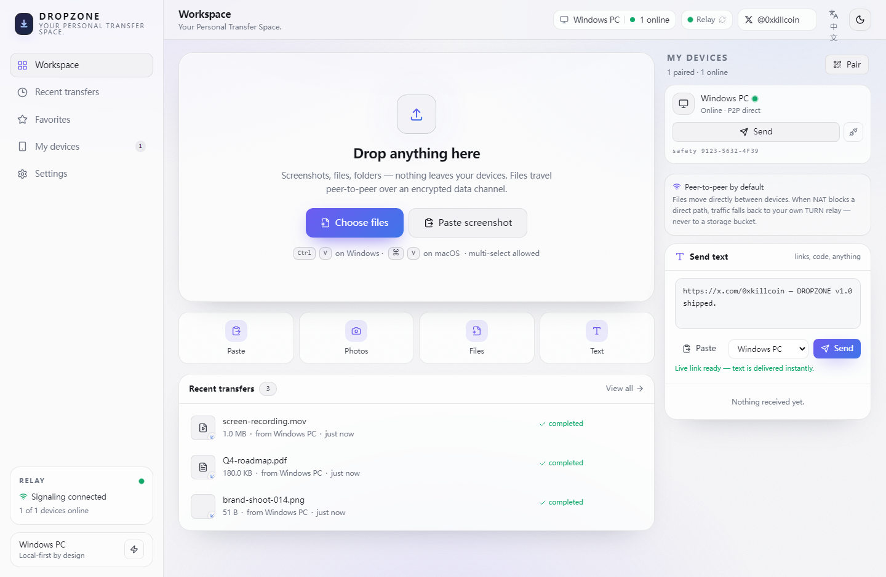
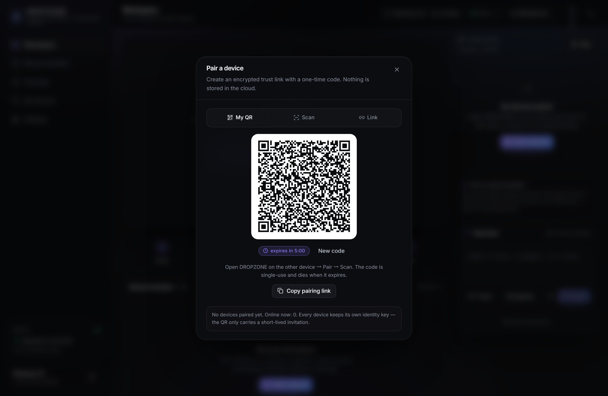
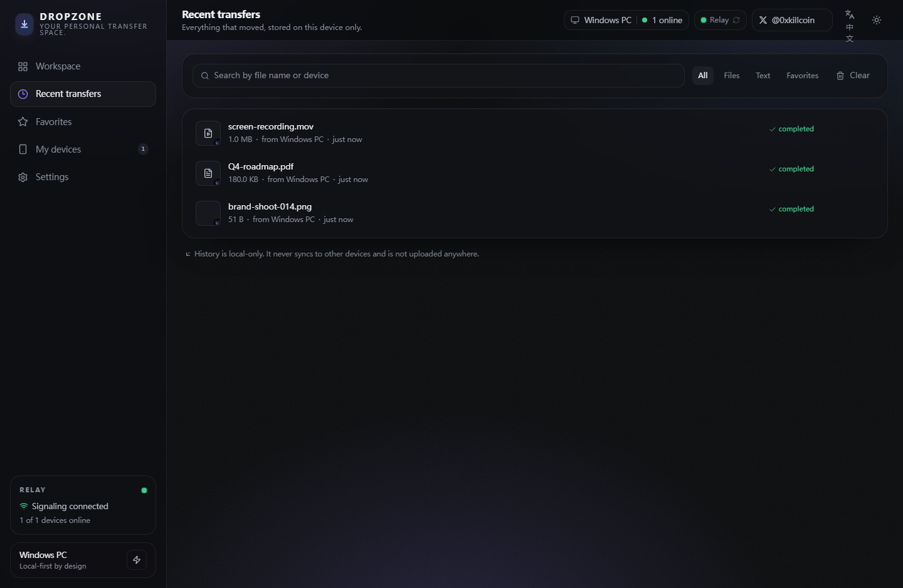
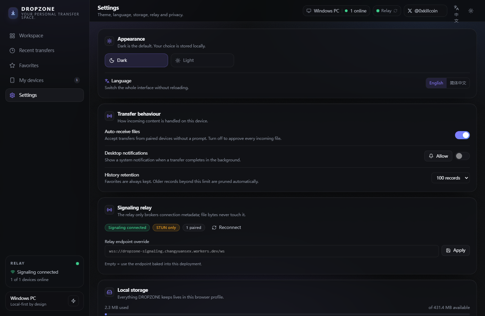
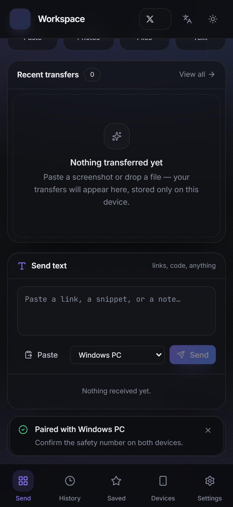
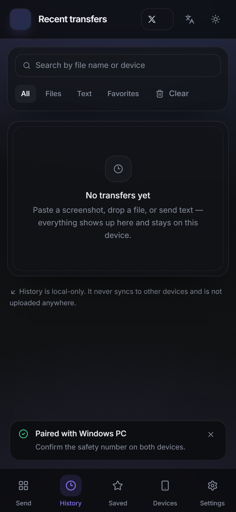
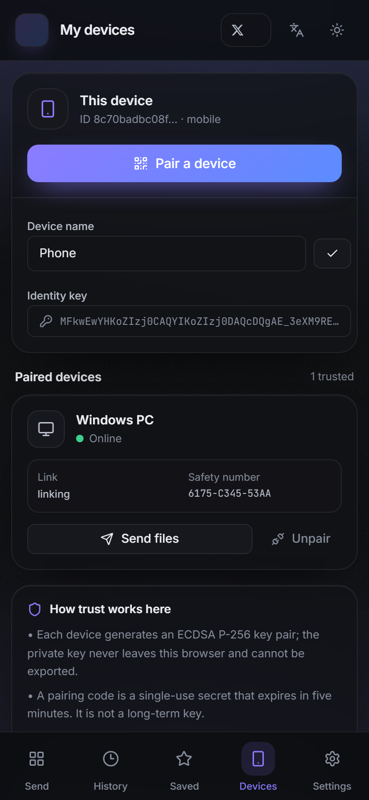
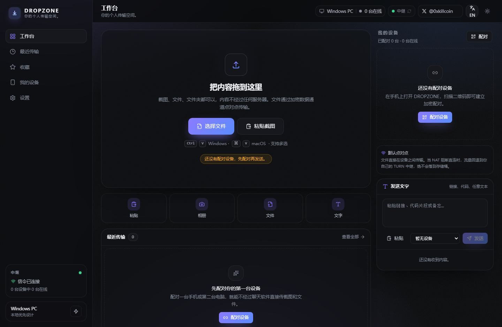
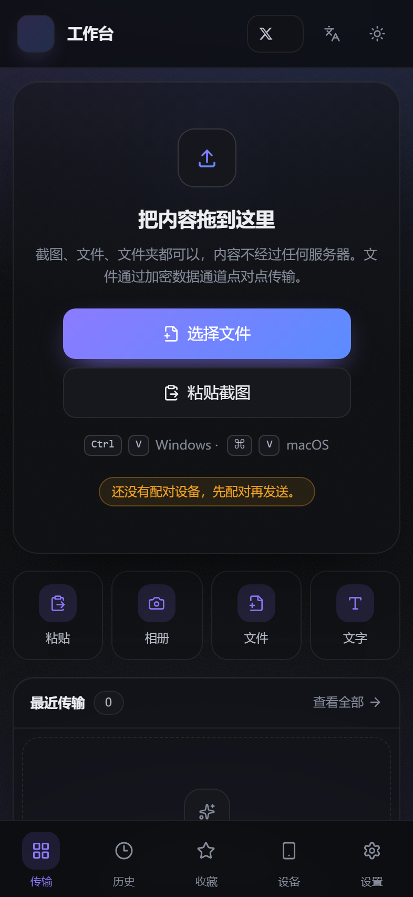

<p align="center">
  
</p>

<h1 align="center">DROPZONE</h1>

<p align="center">
  <strong>Your Personal Transfer Space.</strong><br />
  Local-first, peer-to-peer file transfer between your own devices.<br />
  No accounts · no cloud file storage · no tracking.
</p>

<p align="center">
  <a href="https://iiiiiiiiiiiiiKK.github.io/dropzone/"></a>
  <a href="LICENSE"></a>
  <a href="https://github.com/iiiiiiiiiiiiiKK/dropzone/actions/workflows/ci.yml"></a>
  
  
  
  
  <a href="https://x.com/0xkillcoin"></a>
</p>

<p align="center">
  <a href="https://iiiiiiiiiiiiiKK.github.io/dropzone/"><strong>Live demo</strong></a> ·
  <a href="https://dropzone-signaling.changyuansex.workers.dev/health">Relay health</a> ·
  <a href="docs/architecture.md">Architecture</a> ·
  <a href="docs/protocol.md">Protocol</a> ·
  <a href="docs/deployment.md">Deployment</a> ·
  <a href="docs/faq.md">FAQ</a> ·
  <a href="https://x.com/0xkillcoin">𝕏 @0xkillcoin</a>
</p>

---

## Contents

- [Why DROPZONE](#why-dropzone)
- [Features](#features)
- [Screenshots](#screenshots)
- [Architecture](#architecture)
- [How a transfer works](#how-a-transfer-works)
- [Quick start](#quick-start)
- [Configuration](#configuration)
- [Build, test and checks](#build-test-and-checks)
- [Deployment](#deployment)
- [Security and privacy](#security-and-privacy)
- [Browser support](#browser-support)
- [Verification status](#verification-status)
- [Known limitations](#known-limitations)
- [Roadmap](#roadmap)
- [Contributing](#contributing)
- [License](#license)
- [中文文档](#中文文档)

---

## Why DROPZONE

Moving one file between your own devices is still strangely annoying.

| The usual options | The catch |
| --- | --- |
| Cloud drives | The file is uploaded to someone else's disk, indexed by someone else's account, and lives there until you delete it. |
| Chat apps to yourself | Re-encoded images, compressed video, expiring history, per-app size limits. |
| Email attachments | 25 MB ceilings, one more copy in a sent folder you never clean. |
| USB sticks | Needs proximity, a cable, and a filesystem the other device may not read. |
| "Just use a transfer site" | Upload-first, temporary links, and a promise about deletion you cannot audit. |

**DROPZONE is the workspace you keep instead.** Open it on both devices, pair them once with a QR code, and the bytes travel over an encrypted WebRTC DataChannel directly between the two browsers. The signaling service is a rendezvous point for offers, answers and ICE candidates — it never receives file bytes, file names, or file content. History, favorites and text notes live in your own IndexedDB.

What DROPZONE is not: it is not a cloud drive, not a backup service, and not a fleet-management tool. There is no account to create, nothing to subscribe to, and no server-side copy of your data to forget about.

## Features

**Ingest**

- 📋 **Ctrl/⌘ + V image paste** — paste one or many screenshots; original bytes are preserved (no re-encode, no JPEG round-trip).
- 🖱️ **Drag & drop** — drop files or whole selections onto the workspace; the queue previews thumbnails before sending.
- 📁 **File picker** — multi-select, arbitrary size, streamed through chunks rather than buffered per file.
- ⌨️ **Text / clipboard sending** — send a snippet or a note; it arrives as a selectable, copyable card.

**Pairing and devices**

- 🔳 **QR one-time pairing** — a short-lived, single-use token in a QR payload; no shared password, no long-lived invite link.
- 🛡️ **ECDSA P-256 identity proof** — each device generates a non-extractable P-256 keypair in Web Crypto; pairing completes only after the peer proves possession of its key.
- 🔢 **Safety number** — a deterministic `XXXX-XXXX-XXXX` fingerprint of both public keys that two humans can compare out of band.
- 🖥️ **Device management** — rename, unpair, and see presence (online / offline) for every paired device.

**Transfer**

- 🚚 **Chunked large-file transfer** — 64 KiB chunks over an ordered, reliable DataChannel.
- 🧮 **SHA-256 integrity** — hash computed incrementally while streaming and compared on the receiving side; a mismatch is reported, not silently accepted.
- ⏯️ **Resume inside a live session** — a dropped transfer restarts from the last acknowledged chunk offset while the session is alive.
- 🔔 **Notification toasts** — connect, progress milestones, completion and failures.

**Local workspace**

- 🗂️ **Local-only history** — transfers, favorites and text notes in IndexedDB; nothing syncs anywhere.
- 💾 **Storage usage + export/clear** — see quota usage, export a JSON snapshot, clear history on demand.
- 🌗 **Theme switch** — dark by default, light option persisted per device.
- 🌐 **Bilingual UI** — English and 简体中文, switchable from the top bar (𝕏 / 🌐 button) or Settings without reloading; the choice is stored per device and the whole interface — buttons, dialogs, toasts, transfer states and relative timestamps — follows it.
- 📱 **Responsive layout** — desktop workbench with sidebar, right device rail and history table; mobile layout with bottom navigation and safe-area insets.
- 📲 **Installable PWA** — manifest, service worker shell cache, standalone window.

## Screenshots

<p align="center">
  
</p>

<p align="center"><em>Desktop workspace — dark theme (default), sidebar navigation, paired-device rail and transfer queue.</em></p>

<p align="center">
  
  
</p>

<p align="center"><em>Light theme (left) and one-time QR pairing (right).</em></p>

<p align="center">
  
  
</p>

<p align="center"><em>Transfer history with favorites, and settings (theme, device name, retention, storage, relay URL).</em></p>

<p align="center">
  
  
  
</p>

<p align="center"><em>Mobile layout at 393×852 — bottom tab bar, safe-area insets, touch-sized targets, same local history.</em></p>

<p align="center">
  
  
</p>

<p align="center"><em>Same build, switched to 简体中文 from the top bar — no reload, no separate bundle.</em></p>

## Architecture

```text
┌─────────────────────────────┐                      ┌─────────────────────────────┐
│ Device A · browser / PWA    │                      │ Device B · browser / PWA    │
│ React 19 · Dexie history    │                      │ React 19 · Dexie history    │
└───────────┬─────────────────┘                      └──────────────┬──────────────┘
            │ ① hello · invite · signal (WSS JSON)                  │
            └─────────────────────────────┬─────────────────────────┘
                                          ▼
┌──────────────────────────────────────────────────────────────────────────────────┐
│ Signaling relay — Node + ws  ·  Cloudflare Worker + Durable Object               │
│ rendezvous only: no accounts, no file bytes, no file names                       │
└─────────────────────────────────────────┬────────────────────────────────────────┘
                                          │
                                          ▼ ② STUN discovery · TURN relay
┌──────────────────────────────────────────────────────────────────────────────────┐
│ ③ RTCDataChannel "dropzone.v1" — DTLS/SCTP, end-to-end encrypted                 │
│ 64 KiB chunks · bufferedAmount backpressure · incremental SHA-256                │
└──────────────────────────────────────────────────────────────────────────────────┘


```

Three roles, deliberately separated:

| Role | What it does | What it never does |
| --- | --- | --- |
| **Web app** (`src/`) | Static SPA. Owns identity, storage, UI state, chunking, hashing and the WebRTC peer connection. | Send file bytes to a server. |
| **Signaling relay** (`server/`, `workers/signaling/`) | Rendezvous: device roster, presence, one-time pairing invitations, SDP/ICE relay between already-paired devices, short-lived TURN credentials. | Receive, store, log or forward file bytes, names or content. |
| **TURN relay** (coturn) | Relays the encrypted DTLS stream when ICE cannot find a direct path (symmetric NAT, strict firewalls). | Decrypt anything — it forwards ciphertext. |

Module map, data model and sequence diagrams: **[docs/architecture.md](docs/architecture.md)**. Wire format: **[docs/protocol.md](docs/protocol.md)**.

```text
src/
  main.tsx            app bootstrap, theme class, service-worker registration
  App.tsx             shell (sidebar / topbar / device rail / mobile nav), hash routing, providers
  styles.css          Tailwind v4 entry + design tokens (dark default, .light override)
  lib/
    device.ts         ECDSA P-256 identity, keypair persistence, sign/verify, safety number
    pairing.ts        invite token creation, QR payload encode/decode, expiry checks
    signaling.ts      WebSocket relay client: hello / presence / invite / signal, heartbeat, backoff, roster
    peer.ts           one RTCPeerConnection per device, ICE (STUN + short-lived TURN), DataChannel, getStats
    transfer.ts       framing, 64 KiB chunking, bufferedAmount backpressure, incremental SHA-256, resume, retry
    db.ts             Dexie schema: devices, transfers, files, chunks, texts, settings
    clipboard.ts      paste / drag / file-picker ingestion and object-URL previews
    theme.ts          theme persistence with system fallback
    constants.ts      storage keys, defaults, config resolution
    utils.ts          cn(), formatBytes, relative time, file-kind detection, ids, downloads
  components/         ui.tsx, Logo, TopBar, Sidebar, MobileNav, DropZone, DeviceRail,
                      TransferRow, PairingDialog, TextComposer, Toasts
  views/              Workspace, History, Devices, Settings
server/               Node + ws signaling reference (protocol v1)
workers/signaling/    Cloudflare Worker + Durable Object variant of the same protocol
```

## How a transfer works

**1 · Pairing (once per device)**

1. Device A generates a 32-byte single-use token, keeps it in memory and registers only its SHA-256 hash with the relay (`invite`), with a five-minute expiry.
2. A renders the invitation as a QR payload containing its device id, its public key, its display name, the token and the expiry.
3. Device B scans the QR (or pastes the token), creates its own P-256 identity, and connects with `hello { pairToken }`. The relay checks the hash, the expiry, single use, and that the owner is online — then consumes the invitation.
4. Both sides exchange public keys and prove possession by signing a nonce. B trusts A's key because it came from proximity (the QR); A trusts B's key because B proved it.
5. Both devices display the same `XXXX-XXXX-XXXX` safety number, derived from `SHA-256(pubA | pubB)` with the keys sorted, so a human can confirm both sides match.

**2 · ICE**

6. Each side asks the relay for ICE configuration: STUN servers plus, when configured, coturn credentials minted on demand (`username = "<expiry>:<deviceId>"`, `credential = base64(HMAC-SHA1(TURN_SECRET, username))`). The TURN secret never reaches the browser.
7. SDP offers/answers and ICE candidates travel through the relay as tiny JSON frames. If a direct host/srflx path exists, the DataChannel uses it; otherwise traffic is relayed by TURN, still DTLS-encrypted end to end.

**3 · DataChannel, chunking, hashing**

8. Sender opens the ordered, reliable DataChannel `dropzone.v1` and sends a signed `HELLO`; the receiver verifies the identity proof before accepting anything.
9. Sender writes `META` (id, kind, name, MIME, total size, chunk size); receiver answers `ACCEPT` with an offset — `0` for a fresh transfer, or the last persisted chunk on resume.
10. Chunks are 64 KiB. The sender watches `bufferedAmount`, keeps it under an 8 MiB high-water mark, waits for `bufferedamountlow` (1 MiB) and steps down to 16 KiB chunks when the link is slow.
11. SHA-256 is computed incrementally as bytes stream, so hashing costs no extra pass over the file.
12. On `DONE` the receiver compares digests and answers `VERIFY { ok }`. A mismatch is surfaced to both sides and can be retried once; a match finalizes the record, the toast and the history row.

```text
A  ── META (name, size, mime, chunkSize) ──▶  B
A  ◀── ACCEPT (offset: 0 = fresh, n = resume) ──  B
A  ── CHUNK seq=0 … seq=n (64 KiB each) ──▶  B     (bufferedAmount ≤ 8 MiB)
A  ── DONE (size, sha256) ──▶  B
A  ◀── VERIFY (ok | mismatch) ──  B
```

## Quick start

Requirements: **Node.js >= 20.19** and **pnpm** via Corepack. The frontend is static; the relay is a small Node service.

```sh
corepack enable
pnpm install

# terminal 1 — static app on http://127.0.0.1:5173
pnpm dev

# terminal 2 — signaling relay on ws://127.0.0.1:8787
pnpm dev:signal
```

Open `http://127.0.0.1:5173` in two browser profiles (or one normal + one private window), click **Pair a device** on the first, and scan/paste the code into the second.

> Pairing needs a reachable signaling endpoint. With no configuration the client resolves `window.__DROPZONE_CONFIG__.signalUrl` → `VITE_SIGNAL_URL` → `ws(s)://<current-host>/ws`. For local development the relay must be reachable at the URL you configure; on a static host with no relay, the UI shows the offline state instead of pretending to connect.

## Configuration

**Frontend (build-time or runtime)**

| Variable | Where | Default | Purpose |
| --- | --- | --- | --- |
| `VITE_SIGNAL_URL` | build env | same-origin `/ws` | Public `wss://` signaling endpoint baked into the bundle. |
| `VITE_STUN_URLS` | build env | `stun:stun.cloudflare.com:3478,stun:stun.l.google.com:19302` | Comma-separated STUN list. |
| `window.__DROPZONE_CONFIG__` | `config.js` served next to `index.html` | unset | Runtime override: `{ signalUrl, stunUrls }`. Lets one build serve several deployments. |

A per-device relay URL override is also available in **Settings → Relay URL**; it is stored locally and wins for that device only.

**Signaling service**

| Variable | Default | Purpose |
| --- | --- | --- |
| `PORT` | `8787` | HTTP/WebSocket listen port. |
| `HOST` | `0.0.0.0` | Bind interface. |
| `ALLOWED_ORIGINS` | empty (allow any) | Comma-separated origin allowlist checked on the WebSocket upgrade. Set it in production. |
| `MAX_CLIENTS` | `1000` | Concurrent connection cap (clamped to 1–100000). |
| `MAX_SIGNAL_BYTES` | `32768` | Largest accepted signaling frame (clamped to 1 KiB–32 KiB). File bytes are never accepted at all. |
| `PAIRING_TTL_SECONDS` | `300` | Lifetime of a one-time pairing invitation (clamped to 60–900). |
| `HELLO_TIMEOUT_MS` | `10000` | A socket that never sends `hello` is closed after this. |
| `STUN_URLS` | `stun:stun.l.google.com:19302` | STUN list advertised to clients in `ready`. |
| `TURN_URLS` | unset | coturn endpoint(s). Unset ⇒ no relay path; the UI says so. |
| `TURN_SECRET` | unset | coturn `static-auth-secret`. Used to mint HMAC credentials; never sent to the browser. |
| `TURN_TTL_SECONDS` | `3600` | Lifetime of minted TURN credentials (clamped to 60–86400). |
| `SIGNAL_PUBLIC_URL` | unset | Public URL advertised in `GET /config.json`; otherwise derived from the request. |
| `LOG_LEVEL` | `info` | `error` \| `warn` \| `info` \| `debug`. Log lines never contain file data. |

Copy `.env.example` to `.env` before running the relay locally. Never commit `.env`, TURN secrets, or any deployment credential.

## Build, test and checks

| Command | What it does |
| --- | --- |
| `pnpm dev` | Vite dev server on `127.0.0.1:5173`. |
| `pnpm dev:signal` | Relay with `--watch` on port 8787. |
| `pnpm typecheck` | `tsc --noEmit`. |
| `pnpm build` | `tsc --noEmit && vite build` → `dist/`. |
| `pnpm test` | `vitest run` — 19 unit tests over framing, device identity, pairing and format helpers. |
| `pnpm test:signal` | `node tests/signal-local.mjs` — protocol v1 integration suite against a running relay (add `SIGNAL_URL=…` to point it at a deployment). |
| `pnpm preview` | Serve the built bundle locally. |
| `pnpm start` | Run the relay without watch. |
| `pnpm worker:dev` | Cloudflare Worker variant locally via Wrangler. |
| `pnpm worker:deploy` | Deploy the Worker + Durable Object variant. |

CI ([.github/workflows/ci.yml](.github/workflows/ci.yml)) runs on Node 22 on `ubuntu-latest`: `pnpm install --frozen-lockfile` → `pnpm typecheck` → `pnpm build` → `pnpm test`.

## Deployment

The frontend is a static bundle and the relay is a separate service, so a static host alone cannot run the WebSocket relay. The live demo is split accordingly:

| Piece | Where it runs | URL |
| --- | --- | --- |
| Web UI (PWA) | GitHub Pages | https://iiiiiiiiiiiiiKK.github.io/dropzone/ |
| Signaling relay v1 (Worker + Durable Object) | Cloudflare Workers | `wss://dropzone-signaling.changyuansex.workers.dev/ws` |
| TURN relay | optional, self-hosted coturn | configured through `TURN_URLS` / `TURN_SECRET` |

The bundle reads its relay from `config.json` at runtime, so pointing a fork at your own relay needs no rebuild.

1. `corepack enable && pnpm install && pnpm build` → publish `dist/`.
2. Run the relay behind TLS (`wss://`): Node + reverse proxy, Docker Compose, or `pnpm worker:deploy`.
3. Set `ALLOWED_ORIGINS` to your exact frontend origin, and set `VITE_SIGNAL_URL` (or `window.__DROPZONE_CONFIG__`) to the public `wss://` URL.
4. For restrictive networks, point `TURN_URLS`/`TURN_SECRET` at a coturn instance; keep the secret server-side.

Full steps (GitHub Pages, Cloudflare Pages, Docker/VPS, coturn): **[docs/deployment.md](docs/deployment.md)**.

## Security and privacy

**What never leaves the browser**

- File bytes, file names, text notes and transfer history. There is no upload route anywhere in the project.
- Private keys. The P-256 private key is re-imported as **non-extractable**, so it can sign but cannot be exported back out of Web Crypto.
- TURN credentials are minted server-side per device and expire.

**What the relay sees**

| Sees | Does not see |
| --- | --- |
| Device id, display name, device type, public key, presence, pairing invitation hashes, SDP/ICE payloads, message sizes and timings. | File content, file names, file types, sizes of files, text notes, passwords. |

The relay is nonetheless **trusted for peer discovery**: it learns which devices are online and it could hand you a substituted public key during pairing. That is exactly why DROPZONE shows a safety number and verifies the ECDSA handshake signature — compare the number on both screens if you suspect the relay.

**Transport**

- WebRTC DataChannel is encrypted with DTLS-SRTP/SCTP; when a TURN relay is used it forwards ciphertext only.
- The signaling connection must be `wss://` in production. `ws://` is for local development.
- Content Security Policy, HSTS and origin isolation are the deployment operator's responsibility (see the deployment guide).

**Reporting**

Please report vulnerabilities privately — see [SECURITY.md](SECURITY.md). Do not open a public issue for an active exploit.

## Browser support

| Browser | Desktop | Mobile | Notes |
| --- | --- | --- | --- |
| Chromium 111+ (Chrome, Edge, Brave, Arc) | ✅ | ✅ Android | Full support: DataChannel, clipboard image paste, PWA install, storage persistence. |
| Firefox 115+ | ✅ | ✅ Android | Clipboard images arrive through `paste` events; PWA install depends on platform. |
| Safari 16.4+ (macOS) | ✅ | — | PWA install via *Add to Home Screen*; background tabs are suspended aggressively. |
| Safari on iOS 16.4+ | — | ⚠️ limited | Receiving works while the tab is foregrounded; scripted clipboard reads are unavailable, so paste comes from the system menu. |
| Other evergreen browsers | best effort | best effort | Web Crypto + `RTCDataChannel` are required; report what breaks. |

## Verification status

Everything below was executed against this repository — not estimated.

| Check | Harness | Result |
| --- | --- | --- |
| Unit tests | `pnpm test` (Vitest) | **19 passed**, 4 files: frame encoding/decoding, P-256 identity and signatures, safety numbers, pairing tokens, format helpers |
| Signaling protocol v1 | `pnpm test:signal` | **21 checks passed** on the Node relay (single-use invites, relay-only signalling between paired peers, rate limiting, 32 KiB frame ceiling, TURN HMAC credentials, origin rejection); the same suite passes against the Worker variant under `wrangler dev` |
| Production build | `pnpm build` | `tsc --noEmit` clean, `vite build` emits `dist/` |
| Browser end-to-end | two real Chromium contexts, real user gestures | paired via the one-time QR/link flow, exchanged offer/answer/ICE, completed transfers of **32 B** and **150 000 B** with SHA-256 matching on both sides, files readable from the receiver's IndexedDB |
| Live deployment | the published Pages site + the deployed Worker relay | the same end-to-end flow passed repeatedly with no console errors |
| Responsive audit | 393×852, 820×1180, 1024×800, 1440×940 | no horizontal overflow, no clipped controls, fonts loaded, tap targets ≥ 28 px |
| Clipboard ingest | `Ctrl/Cmd+V` with an image on the clipboard | image staged with original bytes, preview, dimensions and size; no upload involved |
| Bilingual switch | top-bar language button, both directions, plus reload | every screen, dialog, toast and transfer state switches instantly; the choice survives a reload; no horizontal overflow in 中文 at 393 and 1440 px |

## Known limitations

These are real, current behaviours — not roadmap items:

- **Clipboard needs focus and a user gesture.** `navigator.clipboard.read()` requires a focused document and a user gesture; on iOS Safari there is no scripted clipboard read at all, so paste is a manual action.
- **Receiving stops when the tab is not running.** Background receiving ends when the tab or installed PWA is closed or fully suspended. Keep both sides open while a transfer runs.
- **No resume across a page reload.** Resume works within a live session (chunk offset), but after a reload the transfer is marked `interrupted` and can only be restarted from the beginning.
- **The hosted demo relies on one small relay.** Pages serves the UI and a free-tier Cloudflare Worker (`wss://dropzone-signaling.changyuansex.workers.dev/ws`) brokers discovery; no file bytes touch it. Self-host the relay with `wrangler deploy` or Docker Compose to remove the dependency, and unset `config.json.signalUrl` to see the app's offline state.
- **The relay is trusted for discovery.** DTLS encrypts the transport end to end, but peer discovery (who is behind which public key) relies on the relay; key fingerprints and the safety number are the mitigation, not a replacement for it.
- **One active peer connection per paired device.** There is no multi-peer fan-out or broadcast in this version.
- **Browser storage is not a backup.** IndexedDB can be evicted by the browser under storage pressure; export your history if you need a copy.

## Roadmap

- Streaming receive to disk via the File System Access API, with a bounded-memory fallback.
- Cross-reload resume backed by OPFS chunk storage.
- Multi-peer fan-out (send one file to several of your devices at once).
- Explicit device revocation UI with a visible trust ledger.
- Bitrate/adaptive chunk tuning based on `getStats()` round-trip time.
- Real-browser end-to-end tests (two peer contexts, clipboard, mobile layout).

## Contributing

Issues and pull requests are welcome. Start with [CONTRIBUTING.md](CONTRIBUTING.md) — dev setup, branch and commit style, PR checklist, and the no-secrets rule — and [CODE_OF_CONDUCT.md](CODE_OF_CONDUCT.md).

## License

MIT © 2025 DROPZONE contributors (0xkillcoin). See [LICENSE](LICENSE).

---

<p align="center">
  <a href="https://x.com/0xkillcoin"></a>
</p>

<p align="center">
  Built by <a href="https://x.com/0xkillcoin">𝕏 @0xkillcoin</a> ·
  <a href="https://github.com/iiiiiiiiiiiiiKK/dropzone">github.com/iiiiiiiiiiiiiKK/dropzone</a> ·
  MIT
</p>

<p align="center"><sub>Your files stay yours. That is the whole product.</sub></p>

---

## 中文文档

<details open>
<summary><strong>简体中文全量说明（点击折叠 / 展开）</strong></summary>

<p align="center"><strong>DROPZONE · 你的个人传输空间</strong><br />本地优先、在自己设备之间点对点传文件。没有账号，没有云盘存储，没有埋点追踪。</p>

### 这是什么

在自己两台设备之间传一个文件，本来不该这么麻烦。云盘要上传、聊天软件要压缩、邮件有大小限制、U 盘要有线。DROPZONE 换了个思路：两台设备各自打开页面，扫一次二维码完成配对，文件字节通过 WebRTC DataChannel 在两个浏览器之间**直接**传输。信令服务只负责撮合（在线状态、一次性配对邀请、SDP/ICE 转发），它从头到尾都拿不到文件字节、文件名或文件内容。历史记录、收藏和文本便签都存在你自己的 IndexedDB 里。

它不是云盘、不是备份服务、也不是设备管理平台：没有注册、没有订阅、服务器上也没有一份需要你惦记着删掉的数据副本。

### 功能

- 📋 **Ctrl/⌘ + V 粘贴图片**：一次可粘贴多张截图，保留原始字节，不做二次编码。
- 🖱️ **拖拽投放**：把文件或整批选择拖进工作区，发送前可预览缩略图与队列。
- 📁 **文件选择器**：支持多选与大文件，按块流式发送。
- ⌨️ **文本 / 剪贴板发送**：直接发一段文字，对方收到可选中、可复制的卡片。
- 🔳 **二维码一次性配对**：短时效、单次使用的令牌；没有共享密码，没有长期邀请链接。
- 🛡️ **ECDSA P-256 身份验证**：每台设备在 Web Crypto 中生成不可导出的 P-256 密钥对，配对时必须完成签名挑战。
- 🔢 **安全码**：由双方公钥推导出的固定 `XXXX-XXXX-XXXX` 指纹，两个人可以面对面核对。
- 🖥️ **设备管理**：重命名、解除配对、查看在线状态。
- 🚚 **大文件分块传输**：64 KiB 分块，有序可靠 DataChannel。
- 🧮 **SHA-256 完整性校验**：边传边计算增量哈希，接收端比对；不一致会明确报错而非静默接受。
- ⏯️ **会话内续传**：链路中断后从最后确认的块偏移继续；刷新页面则标记为 `interrupted`，只能重新开始。
- 🔔 **通知提示**：连接、进度、完成与失败都有 toast。
- 🗂️ **纯本地历史**：传输记录、收藏与文本便签只存在本机 IndexedDB。
- 💾 **存储用量与导出/清空**：查看配额占用、导出 JSON 快照、按需清空历史。
- 🌗 **主题切换**：默认深色，可切浅色，按设备持久化。
- 🌐 **中英双语界面**：顶栏语言按钮或「设置 → 语言」一键切换 English / 简体中文，无需刷新；按钮、弹窗、提示、传输状态与相对时间全部跟随，选择按设备保存。
- 📱 **响应式布局**：桌面端工作台（侧边栏 + 设备栏 + 历史表格），移动端底部导航与安全区内边距。
- 📲 **可安装 PWA**：manifest、Service Worker 静态壳缓存、独立窗口运行。

### 截图

见上方英文区的 Screenshots 小节：桌面深色/浅色、移动端、配对二维码、传输历史、设置，以及中文界面（`docs/screenshots/dashboard-zh.png`、`mobile-zh.png`）。

<p align="center">
  
</p>
<p align="center">
  
</p>

### 架构要点

| 角色 | 职责 | 不做的事 |
| --- | --- | --- |
| 前端 SPA（`src/`） | 身份、存储、UI 状态、分块、哈希、WebRTC 连接全部在浏览器内完成 | 不向任何服务器发送文件字节 |
| 信令中继（`server/`、`workers/signaling/`） | 设备名册与在线状态、一次性配对邀请、已配对设备之间的 SDP/ICE 转发、按需签发短期 TURN 凭证 | 不接收、不存储、不记录、不转发文件字节/文件名/内容 |
| TURN 中继（coturn） | 当 ICE 无法直连（对称 NAT、严格防火墙）时转发加密的 DTLS 流 | 无法解密，只转发密文 |

模块清单、数据模型表与配对/传输时序图见 [docs/architecture.md](docs/architecture.md)，线格式见 [docs/protocol.md](docs/protocol.md)。

### 传输流程（概要）

1. **配对**：A 生成 32 字节一次性令牌，只把 SHA-256 哈希登记到中继（5 分钟过期）；二维码里带设备 id、公钥、名称、令牌和过期时间。B 扫码后用自己的 P-256 身份发起 `hello { pairToken }`，中继校验哈希、有效期、单次使用与持有者在线，随后作废邀请。双方签名挑战验证私钥持有，并显示同一个安全码。
2. **ICE**：双方从中继取得 ICE 配置（STUN，以及配置了 coturn 时按需生成的 HMAC 短期凭证，`username = "<过期时间>:<deviceId>"`）；SDP/ICE 通过中继以很小的 JSON 帧转发。能直连就直连，否则走 TURN，仍然端到端 DTLS 加密。
3. **DataChannel**：打开有序可靠通道 `dropzone.v1`，发送方先发带签名的 `HELLO`；接收方回 `META/ACCEPT`（`offset=0` 为新传，`n` 为续传偏移）。64 KiB 分块写入，`bufferedAmount` 保持在 8 MiB 高水位以下，`bufferedamountlow`（1 MiB）后继续，弱网自动降到 16 KiB。SHA-256 边传边算，`DONE` 后接收端回 `VERIFY { ok }`，一致则落盘成历史记录，不一致则报错并可重试一次。

### 快速开始

需要 **Node.js >= 20.19** 与 Corepack 提供的 **pnpm**。

```sh
corepack enable
pnpm install

pnpm dev          # 终端 1：静态前端 http://127.0.0.1:5173
pnpm dev:signal   # 终端 2：信令中继 ws://127.0.0.1:8787
```

用两个浏览器配置文件（或普通窗口 + 隐私窗口）打开页面，在 A 上点「配对设备」生成二维码，在 B 上扫码或粘贴令牌即可。信令地址解析顺序为 `window.__DROPZONE_CONFIG__.signalUrl` → `VITE_SIGNAL_URL` → 同源 `ws(s)://<当前域名>/ws`；纯静态托管且没有中继时，界面会显示离线状态，而不是假装已连接。

### 环境变量（摘要）

| 变量 | 默认值 | 用途 |
| --- | --- | --- |
| `VITE_SIGNAL_URL` | 同源 `/ws` | 构建时写入产物的公网 `wss://` 信令地址 |
| `VITE_STUN_URLS` | Cloudflare + Google STUN | 逗号分隔的 STUN 列表 |
| `PORT` / `HOST` | `8787` / `0.0.0.0` | 信令服务监听地址 |
| `ALLOWED_ORIGINS` | 空（放行全部） | 生产环境必须设置为前端准确来源 |
| `PAIRING_TTL_SECONDS` | `300` | 一次性配对邀请有效期（60–900） |
| `MAX_CLIENTS` | `1000` | 并发连接上限 |
| `MAX_SIGNAL_BYTES` | `32768` | 信令帧上限（1 KiB–32 KiB），文件字节根本不会被接受 |
| `TURN_URLS` / `TURN_SECRET` / `TURN_TTL_SECONDS` | 未设置 / 未设置 / `3600` | coturn 地址、`static-auth-secret`、凭证有效期；密钥只留在服务端 |
| `SIGNAL_PUBLIC_URL` / `LOG_LEVEL` | 未设置 / `info` | 对外公布地址、日志级别（日志不含文件数据） |

完整表格见英文区 Configuration。

### 构建与检查

| 命令 | 作用 |
| --- | --- |
| `pnpm typecheck` | `tsc --noEmit` |
| `pnpm build` | 类型检查 + `vite build` → `dist/` |
| `pnpm test` | `vitest run` —— 19 个单元测试，覆盖分帧、设备身份、配对与格式化函数 |
| `pnpm test:signal` | `node tests/signal-local.mjs` —— 针对运行中的中继执行协议 v1 集成测试（加 `SIGNAL_URL=…` 可指向线上部署） |
| `pnpm preview` | 本地预览构建产物 |
| `pnpm worker:dev` / `pnpm worker:deploy` | Cloudflare Worker + Durable Object 变体的本地运行与部署 |

CI 在 Node 22 / `ubuntu-latest` 上依次执行 `pnpm install --frozen-lockfile`、`pnpm typecheck`、`pnpm build`、`pnpm test`。

### 部署

前端是静态产物，信令是独立服务，因此线上演示拆成两部分：**Web UI（PWA）托管在 GitHub Pages**（https://iiiiiiiiiiiiiKK.github.io/dropzone/），**信令中继 v1 运行在 Cloudflare Workers**（`wss://dropzone-signaling.changyuansex.workers.dev/ws`，Worker + Durable Object），TURN 中继可选、由自建 coturn 提供。产物在运行时读取 `config.json` 获得中继地址，因此 fork 之后改指向自己的中继无需重新构建；也可以在构建时通过 `VITE_SIGNAL_URL` 写入。详细步骤（GitHub Pages、Cloudflare Pages、Docker/VPS、coturn）见 [docs/deployment.md](docs/deployment.md)。

### 安全与隐私

- 文件字节、文件名、文本与历史记录从不离开浏览器；仓库里没有任何上传路由。
- P-256 私钥以**不可导出**方式重新导入 Web Crypto，只能签名、无法导出。
- 中继能看到：设备 id、显示名、设备类型、公钥、在线状态、配对邀请哈希、SDP/ICE 内容、消息大小与时序。中继看不到：文件内容、文件名、文件类型、文件大小、文本便签。
- 中继在**对端发现**环节仍然是被信任的：它知道谁在线，理论上可以在配对时替换公钥——这正是安全码与 ECDSA 签名校验存在的理由，怀疑时可双方核对安全码。
- TURN 只转发密文；`wss://` 是生产必需，`ws://` 仅供本地开发。

### 验证状态（真实执行）

| 检查项 | 方式 | 结果 |
| --- | --- | --- |
| 单元测试 | `pnpm test`（Vitest） | **19 个全部通过**：分帧编解码、P-256 身份与签名、安全码、配对令牌、格式化函数 |
| 信令协议 v1 | `pnpm test:signal` | Node 中继上 **21 项检查通过**（一次性邀请、仅已配对设备可转发、限流、32 KiB 帧上限、TURN HMAC 凭证、来源拒绝）；同一套测试在 `wrangler dev` 的 Worker 变体上同样通过 |
| 生产构建 | `pnpm build` | `tsc --noEmit` 无错误，`vite build` 产出 `dist/` |
| 浏览器端到端 | 两个真实 Chromium 上下文 + 真实用户操作 | 通过一次性二维码/链接完成配对，交换 offer/answer/ICE，**32 B** 与 **150 000 B** 文件传输完成后双方 SHA-256 一致，接收端可从 IndexedDB 读出文件 |
| 线上部署 | 线上 GitHub Pages + 已部署的 Worker 中继 | 同一套端到端流程多次通过，控制台无报错 |
| 响应式检查 | 393×852、820×1180、1024×800、1440×940 | 无横向溢出、无控件裁切、字体正常加载、触控目标 ≥ 28 px |
| 剪贴板 | 剪贴板中放图片后按 `Ctrl/Cmd+V` | 原始字节入队，显示缩略图、尺寸与大小，全程不上传 |

### 已知限制（真实行为）

- 剪贴板读取需要页面聚焦与用户手势；iOS Safari 完全不开放脚本读取剪贴板，只能手动粘贴。
- 标签页或 PWA 未运行时无法后台接收，传输期间请保持双方页面打开。
- 刷新页面后不支持续传：记录标记为 `interrupted`，只能从头重传；会话内的续传是可用的。
- 托管演示（GitHub Pages）只有静态 UI，需要自建信令；未配置时显示离线状态。
- 每台已配对设备同时只维持一条对等连接，没有多播/群发。
- 浏览器存储可能被清理，IndexedDB 不是备份；需要留存请使用历史导出。

### 路线图

- 通过 File System Access API 流式写盘接收，其余浏览器使用有界内存回退。
- 基于 OPFS 的跨刷新续传。
- 一对多群发（一次发往多台自己的设备）。
- 显式的设备撤销界面与可见的信任台账。
- 依据 `getStats()` 往返时延自适应调整分块与速率。
- 真实浏览器端到端测试（双对等上下文、剪贴板、移动布局）。

### 贡献与许可

欢迎 issue 与 PR，请先阅读 [CONTRIBUTING.md](CONTRIBUTING.md) 与 [CODE_OF_CONDUCT.md](CODE_OF_CONDUCT.md)；安全问题见 [SECURITY.md](SECURITY.md)。

MIT © 2025 DROPZONE contributors (0xkillcoin)，详见 [LICENSE](LICENSE)。

</details>

---

<p align="center">
  <a href="https://x.com/0xkillcoin"><strong>𝕏 @0xkillcoin</strong></a>
</p>
